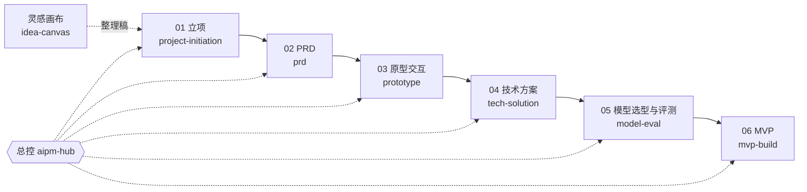

# AIPM Skill Pack

**AI 产品经理从想法做到 MVP 用的 8 个 Agent Skill，全部自己写。** 中文，按「立项 → PRD → 原型交互 → 技术方案 → 模型选型与评测 → MVP」六个节点组织，另有一个随时可用的灵感画布整理；总控按风险推荐下一步，不要求死板按顺序走。任何认 `SKILL.md` 格式的 Agent 都能用（DeepSeek Harness、Claude Code、Codex 等）。

这套 skill 是 [拾阶](https://github.com/ZeroOnehub/aipm-workbench)（我基于 DeepSeek Harness 做的 AI 产品工作台）的全部 skill。单独拿出来也能用。

---

## 流程



| 节点 | skill | 站 | 主要产出 |
|---|---|---|---|
| 总控 | `aipm-hub` | 定位项目、读进度、按风险推荐下一步、处理待办、交接、新需求的升版顺序、老项目升级 | 进度文件 `aipm.json` |
| 灵感画布 | `idea-canvas` | 读画布 → 打开链接 → 定性 → 分主题 → 写回画布 → 整理稿 → 问去向 | 整理后的画布、整理稿 |
| 01 立项 | `project-initiation` | 把问题说清 / 找到真用户 / 收进需求池 / 看清对手 / 排出先后 / 拍板立项 | 立项报告（md + html） |
| 02 PRD | `prd` | 背景与目标 / 用户与旅程 / 功能清单 / 功能需求与交互 / AI 设计 / 非功能、评测与定稿 | PRD |
| 03 原型交互 | `prototype` | 页面清单 / 线框图 / 可点击原型 / 走查回写 | 线框图、可点击原型（单文件 HTML） |
| 04 技术方案 | `tech-solution` | PRD 体检 / 技术适配 / 架构设计 / 评审定稿 | PRD 补全清单、技术适配声明、技术方案、决策台账 |
| 05 模型选型与评测 | `model-eval` | 定目标 / 候选模型调研 / 定标准 / 建评测集 / 跑评测 / 归因与报告 | 候选模型表、评测方案、评测集、评测报告 |
| 06 MVP | `mvp-build` | 开发准备 / 后端 MVP / 前端风格 / 正式前端 / 联调验收 | 能跑的 MVP 代码仓库、证据包、验收报告 |

---

## 每个 skill 干什么

### `aipm-hub`：总控

不写产出物，只管项目：新建或打开项目、三五行讲清进度（包括 MVP 代码做到哪了）、按风险推荐下一步（挡路的决定 → 卡住的站 → 最危险的假设 → 上游改了下游没跟 → 默认顺序）、处理项目面板「去处理」带进来的待办、把活交给对应节点的 skill。来了新需求，按「PRD 升版 → 技术方案升版 → 评测加题重跑 → MVP 同步」安排。老格式项目可以一键升级到新流程（`scripts/migrate_v1.py`，文件一个不删）。

> 试试这样说：「新建项目，我想做一个帮研究员写可研报告的 AI 助手」「佳境下一步做什么」

### `idea-canvas`：灵感画布整理

平时把点子、文章链接、竞品、脑暴文档随手丢进拾阶的无限画布（开放的 JSON Canvas 格式，Obsidian 也能打开）。一键整理时：读全部节点，打开每个链接写摘要，给每条素材定性（亲历、公开资料、个人看法、AI 推断），分 3–7 个主题写回画布（用户的节点一个不删，第一次整理前自动备份），另写一份整理稿，最后问去向：开新项目立项、补进某个项目的某个阶段，还是先放着。

> 试试这样说：点画布上的「AI 一键整理」；或「整理一下灵感画布」

### `project-initiation`：立项

六站立项教练，从一句话想法或零散材料出发，逐站追问、补证据，产出写给老板拍板的立项报告。每个结论都要追得到证据（用户原话、行为数据、公开资料、测算……），没证据的老实写「待验证」。支持 0→1 新项目和 1→N 阶段规划。

> 试试这样说：「帮我立项：制造业新人学设备太慢，想做个 AI 带教」

### `prd`：PRD

把立项结论写成研发能开工、评测能出题的 PRD。七大节：基础信息（版本、变更日志、名词解释）；项目背景（「维度 × 现状 / 痛点 / 机会点」表、北极星与商业 / 业务 / 技术四层目标、用户画像卡、原始用户流程图）；功能规划（每个功能一句可判定的验收标准、优先级、里程碑）；功能需求（设计流程图、核心交互逻辑图、系统处理流程，按「入口 / 交互 / 反馈」写的详细交互，**全局上下文结构和每个 Agent 的完整提示词**，埋点，权限）；非功能需求（七类都量化，含成本）；评测需求；兜底策略。分六站写，每站有关卡，最后按自审清单定稿；之后的改动一律走升版。

> 试试这样说：「立项过了，开始写 PRD」「PRD 的 Agent 提示词那一节帮我写」

### `prototype`：原型交互

从 PRD 推出页面清单和跳转图，画灰白线框图（标注编号对回 PRD 交互说明），再做能点的单文件原型：主流程可以从头点到尾，每个区域的状态（空、加载、流式输出、部分完成、失败、被拒答、没找到依据……）都能在右下角的状态面板里切换。最后对照 PRD 逐条走查，把页面编号和发现回写进 PRD。不做视觉，视觉在 MVP 阶段挑参考再定。

> 试试这样说：「按 PRD 画原型」「原型走查一下」

### `tech-solution`：技术方案

PRD 写完后做四站：**PRD 体检**（对照八类信息和三类 AI 问题查缺口，分「必须问 ≤5 个 / 可默认 / 矛盾」，补齐后 PRD 升版）；**技术适配**（产品形态、后端先行还是纵向切片、默认技术栈、按需模块、十条底线逐条检查，产品经理只确认三件事）；**架构设计**（先判断单次调用 / 固定流水线 / Agent，14 个 Agent 特征按固定规则选组件，七层架构、数据与状态、接口与工具、上下文与提示词怎么落地、兜底实现、成本测算、开发分期）；**评审定稿**（开一个子代理独立审稿，决策台账不超过 10 项）。附 17 个 Agent 组件的参考实现。

> 试试这样说：「PRD 定稿了，做技术方案」

### `model-eval`：模型选型与评测

评测是为了做决定。六站：定目标（要做的决定写成可选的选项；评测对象是整条链路，不是一个模型）；候选模型调研（按能力要求上网查官方文档和价格，每个数据带来源和日期，候选覆盖强、省、合规三类）；定标准（结果、过程、红线三层，红线碰一次就判不过）；建评测集（只用一个真实项目的资料，先找资料里的坑，正常 / 边界 / 红线 / 反例四种题型，每题标环节和专项，业务专家确认答案）；跑评测（能用代码判的先用代码判，评审模型和被测模型不同厂商，每题跑三次都过才算过）；归因与报告（按「数据缺失 → 检索没召回 → 提示词没写清 → 模型能力不够」的顺序排查，给出每个环节用哪个模型）。

附 `scripts/run_eval.py`：只用 Python 标准库，调 OpenAI 兼容接口（DeepSeek、通义千问、智谱、Kimi、豆包等），支持工具调用的固定返回、15 种代码判定、评审模型、多次运行和汇总表；`--app-url` 模式把同一套题送进 MVP 的真实链路。Key 只从环境变量读。

> 试试这样说：「对比几个模型，出评测集」「先做个快速小样，看 AI 能不能做到」

### `mvp-build`：MVP

把产品做出来。安装脚本建一个独立的代码仓库（默认在项目的 `06-MVP/app/`）：规则卡 `AGENTS.md`（十条底线、阶段闸门是否表、证据包）、技术栈 / 前端 / 上线部署三份手册、前端风格选型和联调验收两份做法、自检脚本 `verify.sh`、拾阶交接的 PRD 和技术方案和评测集、从 PRD 抽出的提示词、技术方案选中的参考组件。然后五站：开发准备；后端 MVP（按技术方案分期，用评测集的题做真实冒烟）；**前端风格**（上网找 3–4 个参考，把代表页做成几种风格放在一页里让你挑，挑定后写设计规范）；正式前端（按原型和设计规范）；联调验收（评测集走真实链路、PRD 功能逐条对照、兜底抽查、验收报告）。代码可以由拾阶里的 AI 写，也可以用 Claude Code、Codex 打开代码仓库接着写，规则卡对它们同样有效。

> 试试这样说：「开始做 MVP」「挑前端风格」「验收 MVP」

---

## 安装

### 拾阶 / DeepSeek Harness

拾阶会扫描「当前工作区/.dsh/skills」，所以只要在工作区里建一个指向本仓库 `skills/` 的链接：

```bash
git clone https://github.com/ZeroOnehub/aipm-skill-pack.git
cd aipm-skill-pack
./install.sh --workspace "<你的拾阶工作区>"
```

链接是整个目录，以后 `git pull` 拿到的更新会自动生效，不用重启。

### Claude Code、Codex 等其他 Agent

把每个 skill 链接进对应的 skills 目录（已有同名目录的会跳过，不会覆盖）：

```bash
./install.sh ~/.claude/skills    # Claude Code
./install.sh ~/.codex/skills     # Codex
```

装好后直接用中文说需求就会触发，也可以用 `/<skill 名>` 显式调用。从旧版升级的：旧版的 22 个 skill 里有 19 个已经删除，用 `install.sh <目录>` 装在别的 Agent 里的，删掉那些失效的链接即可。

---

## 项目文件

每个项目一个文件夹，进度写在 `aipm.json`（格式见 [`aipm-hub/references/aipm-json.md`](skills/aipm-hub/references/aipm-json.md)）：

```
<工作区>/
├── 灵感画布/                 工作区级画布
└── <项目名>/
    ├── aipm.json
    ├── 灵感画布.canvas        项目级画布（可选）
    ├── 01-立项/  02-PRD/  03-原型交互/  04-技术方案/  05-模型评测/
    └── 06-MVP/app/           MVP 代码仓库
```

## 写这套 skill 的原则

1. **产出物是给下一步用的**：PRD 的提示词就是评测的被测对象，评测的选型结论回填技术方案，技术方案的开发分期就是 MVP 的阶段，评测集最后在 MVP 的真实链路上再跑一遍。
2. **每站有关卡**：关卡是可判定的清单，不过就说哪条没过、怎么补。
3. **证据纪律**：结论标来源，拿不到的写「待验证」，不编。
4. **能用脚本判的不让 AI 判**：组件选型、画布整理、评测判定、MVP 的五项自检都是确定性脚本。
5. **只给一个推荐**：要拍板的事写成决策卡（问题、选项、推荐、不选的后果），一次不超过 5 个。

## 协议

MIT，见 [LICENSE](LICENSE)；第三方声明见 [NOTICE.md](NOTICE.md)。
