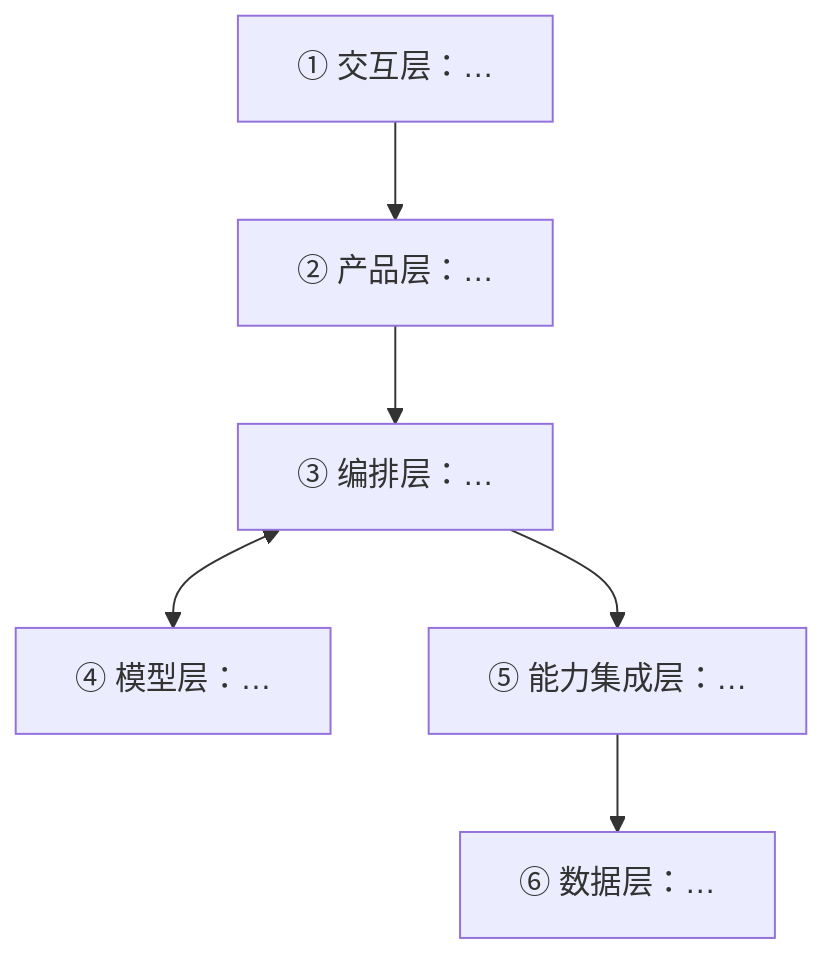

# <项目名> 架构方案

| 项 | 内容 |
|---|---|
| 版本 | v1 |
| 输入 | `02-PRD/PRD.md`（版本 <x>）、<其他输入> |
| 状态 | 草稿 / 待确认 / 已确认 |
| 选型方式 | 运行 `select_components.py` / 未运行选型脚本（手工按规则推） |

## 1. 形态判断

- 结论：单次调用 / 固定流水线 / Agent
- 依据：<引用 PRD 原文>
- 什么情况下要升级形态：<条件>

## 2. 模型与成本

| 项 | 结论 | 来源 |
|---|---|---|
| 主模型 | | |
| 兜底模型 | | |
| 单次任务调用 | 几次，每次约多少输入 / 输出 token | 【测算】或【实测】 |
| 单次成本 | | 价格链接与日期 |
| 月成本上限 | | PRD 预计用量 |
| 时延 | 预计 / PRD 要求 | |

## 3. 需求拆解

| 维度 | 结论 | 状态 | 出处 |
|---|---|---|---|
| 目标 | | 明确 / 待确认 | |
| 用户 | | | |
| 核心闭环 | | | |
| 交付物 | | | |
| 边界 | | | |
| 约束 | | | |

## 4. 组件选型（Agent 形态）

<粘贴 select_components.py 的输出表格；其他形态写「不适用：<形态>」>

## 5. 架构图

| 层 | 本产品的做法 |
|---|---|
| ① 交互层 | |
| ② 产品层 | |
| ③ 编排层 | |
| ④ 模型层 | |
| ⑤ 能力集成层 | |
| ⑥ 数据层 | |
| ⑦ 基础设施层 | |

## 6. 工具清单

| 工具 | 输入 | 输出 | 副作用 | 权限 | 层 |
|---|---|---|---|---|---|

## 7. 降级策略

| 场景 | 怎么处理 | 用户看到什么 |
|---|---|---|
| 工具失败 | | |
| 模型幻觉 | | |
| 超时 | | |
| 越权 | | |

## 8. 可观测

- 日志：
- 指标（对应 PRD 指标）：
- 轨迹：

## 9. 上下文与记忆

## 10. 部署形态

## 11. 自审（不是独立审稿）

| 标准 | ✓ / ✗ | 说明 |
|---|---|---|
| 可运行 | | |
| 可容错 | | |
| 可观测 | | |
| 可测试 | | |
| 可部署 | | |
| 可度量 | | |

## 12. 待确认清单

1. <问题>（已写入 aipm.json pending：D?）
