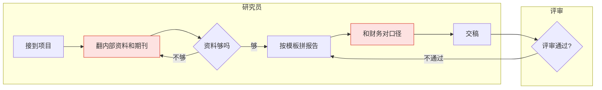

# 第 02 站：用户与旅程

**写什么：** 第二节的「用户画像」「原始用户流程」。
**回答的问题：** 到底为谁做？他们现在是怎么干活的，卡在哪一步？

## 1. 用户画像

立项第 02 站已经做过调研的，直接从 `01-立项/02-用户画像与调研结论.md` 搬过来改写，不重新问；没做过的，先告诉用户画像没有调研支撑，画像里的内容都标【AI 推断】或【用户口述】，并在待定问题里记一条「找 3–5 位目标用户访谈」。

### 写几个角色

- **用的人**和**买单 / 管理的人**分开写，他们的痛点和诉求往往不同（研究员要快，管理员要口径统一、能管权限）。
- 第一版只服务一个核心角色时，其他角色写一行说明「本期只做到 xx」即可。
- 角色数 ≤ 4。超过 4 个说明范围太大，回头看立项的 MVP 范围。

### 每个角色一张卡

```markdown
#### 李工：氢能产业公司可行性研究员 / 技术顾问

- **背景**：化工硕士，从业 5 年，熟悉电解槽技术路线和成本构成
- **核心任务**：
  - 评估项目的技术可行性、经济效益和风险
  - 撰写可研报告，向不同背景的同事讲清楚
- **痛点**：
  - 资料散在不同文件夹和纸质档案里，光找资料就要一两天 【用户原话】
  - 每份报告结构大同小异，大量时间花在复制粘贴和换说法 【用户原话】
- **期望**：「有个工具把资料聚起来，问它就像问一位资深专家；能按公司格式一键出框架。」 【用户原话】
```

- 名字可以虚构，身份、任务、痛点必须来自调研或用户口述。
- **痛点写场景，不写结论**：「资料散在不同文件夹，光找就要一两天」，而不是「信息检索效率低」。
- **期望用用户自己的话**，加引号，标【用户原话】。

卡片之后加一张汇总表（需求方 / 场景 / 痛点 / 诉求），方便研发和评审扫一眼。

## 2. 原始用户流程

画**没有这个产品时**，用户今天怎么完成任务。目的是确认功能逻辑没走偏：什么人、在什么地方、做什么事、期望什么结果，痛点卡在哪一步。

### 怎么画

1. 按时间顺序列出 6–12 个步骤，每步是「谁 + 动作」。
2. 标出**痛点步骤**（红色）：耗时最长、最容易出错、最依赖某个人的那几步。痛点要能对回画像卡里的痛点。
3. 有分支（找不到资料、返工）就画出来，返工回路是最值钱的信息。
4. 多角色协作时用泳道（Mermaid 的 `subgraph`），一个角色一条。



5. 图下面用一张表写痛点步骤：

| 步骤 | 现在花多少 | 为什么卡 | 对应画像痛点 |
|---|---|---|---|
| 翻资料 | 1–2 天 | 资料分散、要逐份验证 | 李工痛点 1 |

### 自检

- [ ] 每个角色有背景、核心任务、痛点、期望，痛点和期望带证据标签
- [ ] 区分了用的人和买单 / 管理的人
- [ ] 原始流程画的是「现在」，不是「用了我们的产品之后」
- [ ] 痛点步骤标红，并在表里对回画像痛点
- [ ] 至少画出一条返工或失败回路
