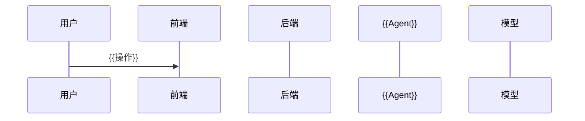

# {{产品名}} PRD v{{版本}}

| 文档类型 | 说明 | 链接 |
|---|---|---|
| 立项报告 | 做不做、先做多小 | `01-立项/立项报告.md` |
| 原型 | 本次设计的可点击原型 | {{`03-原型交互/原型-xxx.html`，还没做写「待 03 阶段」}} |
| 高保真 | 设计图 | {{Figma / 墨刀链接，没有写「无」}} |
| 技术方案 | | {{`04-技术方案/技术方案.md`，还没做写「待 04 阶段」}} |
| 评测方案 | | {{`05-模型评测/评测方案.md`，还没做写「待 05 阶段」}} |

## 一、基础信息

### 版本信息

- 产品版本：v{{版本}}
- 创建时间：{{日期}}
- 负责人：{{姓名}}

### 变更日志

| 时间 | 文档版本 | 变更人 | 主要变更内容 |
|---|---|---|---|
| {{日期}} | v0.1 | {{姓名}} | 初版建立 |

### 名词解释

| 术语 / 缩略词 | 说明 |
|---|---|
| {{术语}} | {{一句话定义；指标类术语写清计算口径}} |

## 二、项目背景

### 需求背景

{{一段话：谁，在什么工作里，要完成什么任务，现在要花多少时间 / 钱 / 返工，期望做到多好。每个数字带证据标签。}}

| 维度 | 现状 | 痛点 | 机会点 |
|---|---|---|---|
| 业务 | | | |
| 数据 / 知识 | | | |
| 质量 / 风险 | | | |
| {{其他维度}} | | | |

### 项目目标

| 类型 | 指标与目标 | 口径与数据来源 |
|---|---|---|
| 北极星 | {{时间窗}}内，{{指标}} = {{公式}} ≥ {{目标值}} | {{怎么算、从哪取数}}；为什么是它：{{它直接衡量产品为用户创造的核心价值}} |
| 商业 | | |
| 业务 | | |
| 技术 | | |

### 用户画像

#### {{角色名}}：{{一句话身份}}

- **背景**：{{从业年限、专业、所在组织}}
- **核心任务**：
  - {{任务}}
- **痛点**：
  - {{具体到场景的痛点}} {{证据标签}}
- **期望**：{{用他自己的话}} {{证据标签}}

| 需求方 | 场景 | 痛点 | 诉求 |
|---|---|---|---|
| {{角色}} | | | |

### 原始用户流程

{{一句话说明：现在没有这个产品时，用户是怎么完成任务的；红色节点是痛点。}}

```mermaid
flowchart LR
  A[{{起点}}] --> B[{{步骤}}]
  B --> C[{{痛点步骤}}]
  classDef pain fill:#fde2e1,stroke:#d93025
  class C pain
```

## 三、功能规划

### 功能清单

| 一级功能 | 二级功能 | 验收标准（单句） | 优先级 | 里程碑 | 完成日期 | 负责人 |
|---|---|---|---|---|---|---|
| {{模块}} | {{功能}} | {{一句话，可判定}} | P0 | M1 | | |

### 本期不做

- {{功能}}：{{为什么不做；什么时候再看}}

## 四、功能需求

### 流程设计

#### 设计流程图

```mermaid
flowchart TD
  start([{{入口}}]) --> step1[{{步骤}}]
```

#### 核心交互逻辑图

```mermaid
stateDiagram-v2
  [*] --> {{状态}}
```

#### 系统处理流程



### 详细交互设计

| 模块 | 功能名称 | 原型图 | 详细交互说明 |
|---|---|---|---|
| {{模块}} | {{功能}} | {{原型页编号，如 P02；待 03 阶段回写}} | **入口**：……<br>**交互**：……<br>**反馈**：…… |
| {{模块}} | 空状态 | | {{什么情况下出现、显示什么、引导做什么}} |
| {{模块}} | 异常处理 | | {{每种异常一行：触发 → 提示原文 → 可以做什么}} |

### 全局上下文管理

{{一段话：整条 AI 链路要共同记住哪些东西，为什么要分块。}}

```json
{
  "config": {},
  "truth_base": {},
  "memory": {},
  "runtime": {}
}
```

| 区块 | 存什么 | 谁写 | 谁读 | 生命周期 |
|---|---|---|---|---|
| `config` | | | | |

### Agent 提示词设计

{{一句话：链路有几个环节，顺序是什么。}}

#### {{环节名}} Agent

- **职责**：{{一句话}}
- **触发**：{{什么时候调用}}
- **读**：{{全局上下文里的哪些字段}}　**写**：{{产出写回哪里}}
- **工具**：{{工具名：入参，目的}}

```markdown
# Role
# Global Context
# Inputs
# Action Path
# Tool Use Rules
# Output Specifications
# Constraints
```

### 数据埋点需求

{{一句话：用户核心旅程拆成哪几段漏斗。}}

| 埋点 ID | 事件名称 | 事件描述 | 触发条件 | 数据收集内容 |
|---|---|---|---|---|
| 1001 | {{阶段_动作}} | | | UserID、Timestamp、…… |

### 角色权限设计

| 功能集 | 功能点 | {{角色 1}} | {{角色 2}} |
|---|---|---|---|
| | | ✔️ | |

## 五、非功能需求

| 类别 | 描述 | 详情 |
|---|---|---|
| 1. 性能 | 响应速度、处理能力、并发 | |
| 2. 可靠性 | 可用性、容错、数据完整 | |
| 3. 安全性 | 认证、授权、数据保密、审计 | |
| 4. 易用性 | 学习成本、操作效率、一致性 | |
| 5. 兼容性 | 终端、浏览器、文件格式 | |
| 6. 可维护性 | 模块化、可配置 | |
| 7. 成本 | 单次任务模型成本、月度预算 | |

## 六、评测需求

{{谁来出题、评测对象（整条链路还是某个环节）、题量和题型、每题跑几次算过、红线、改了什么要重跑。详细方案链接到 05 阶段的评测方案。}}

## 七、兜底策略

| 触发条件 | 系统行为 | 用户感知 |
|---|---|---|
| {{可判定的条件}} | {{系统怎么做}} | {{用户看到的原文}} |

## 附：假设与待定问题

| 编号 | 内容 | 类型 | 影响哪几节 | 怎么验证 / 谁来定 | 状态 |
|---|---|---|---|---|---|
| Q1 | | 待验证 / 待拍板 | | | 开放 |
