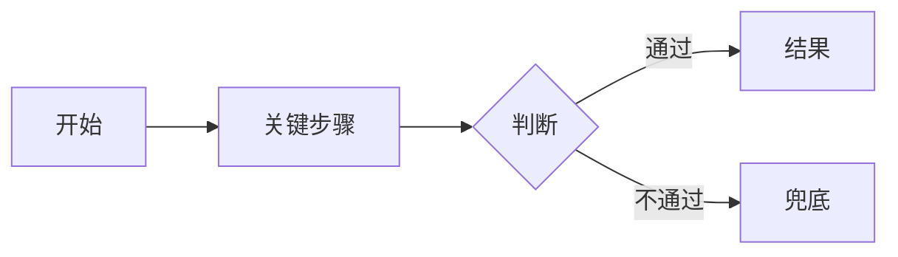

# {产品 / 功能名} PRD

| 项 | 内容 |
|---|---|
| 版本 | v0.1（精简版） |
| 负责人 | {姓名} |
| 更新 | {YYYY-MM-DD} |
| 输入 | {立项报告路径，或「未经立项」} |
| 状态 | 草稿 / 评审中 / 已定稿 |

## 1. 摘要

{两三句：是什么、给谁、为什么是现在。}

## 2. 背景

{发生了什么变化，或者什么事刚变得可能。关键事实带证据标签。}

## 3. 目标与非目标

**目标**

| 目标（结果） | 关键结果 | 基线 | 目标值 |
|---|---|---|---|
| {例：让运营不用手工整理周报} | {周报首次可用率} | {待测量} | {≥ 70%} |

**非目标**

- {不做的事} —— {理由}

## 4. 目标人群与价值主张

### 人群 A：{按问题或任务命名}

- **谁**：
- **为什么**：
- **之前**：
- **怎么解决**：
- **之后**：
- **替代方案**：

> 价值主张：{一两句话}

## 5. 用户故事

- 作为 {具体用户类型}，我想要 {能力}，以便 {收益}。

## 6. 功能清单

| 优先级 | 功能 | 行为描述 | 连回的痛点 | 依赖 |
|---|---|---|---|---|
| P0 | | | | |
| P1 | | | | |
| P2 | | | | |

## 7. 主流程与异常流程

| 异常 | 系统怎么做 | 用户看到什么 |
|---|---|---|
| 输入缺失或不合法 | | |
| 外部服务失败 | | |
| AI 输出不可用 | | |
| 用户中途放弃 | | |
| 权限不足 | | |

## 8. 验收标准

**{P0 功能名}**

- Given {前提}，When {操作}，Then {结果}
- 不应发生：{反例}

## 9. AI 能力边界

| 项 | 内容 |
|---|---|
| AI 负责 | |
| AI 不负责 | |
| 为什么非用 AI | |
| 已知会怎么错 | |
| 错了怎么兜 | |
| 人在哪接手 | |
| 数据与隐私 | |

## 10. 评测样例

| # | 类型 | 输入 | 期望行为 | 判定方式 |
|---|---|---|---|---|
| 1 | 正常 | | | |
| 2 | 边界 | | | |
| 3 | 对抗 | | | |

## 11. 指标、上线条件与停止条件

| 指标 | 类型 | 口径 / 分母 | 周期 | 基线 | 达标线 | 冲刺线 |
|---|---|---|---|---|---|---|
| | 先行 | | | | | |
| | 滞后 | | | | | |

- **上线条件**：
- **停止条件**：

## 12. 风险

| 风险 | 可能性 | 影响 | 应对 |
|---|---|---|---|

## 13. 版本范围

- **第一版**：
- **后续**：
- **明确不做**：
- **预计周期**：{相对时间，例：约两周}

## 14. 假设与待定问题

| # | 问题 | 由谁回答 | 是否阻塞开工 |
|---|---|---|---|
