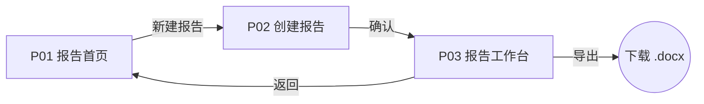

# 第 01 站：页面清单

**产物：** `页面清单.md`
**回答的问题：** 一共几页？每页给谁、干什么、有哪些状态？页面之间怎么跳？

## 1. 从 PRD 推页面

1. 把 PRD 详细交互设计表里的每个「入口」念一遍：入口在哪一页，那一页就要有；入口说「弹出」「侧边栏」的，是页内浮层，不单独算页。
2. 按用户任务顺序排：首页 / 列表 → 创建 → 核心工作页 → 结果 / 导出 → 设置 / 管理。
3. 合并：两个功能总是一起用、读同一份数据的，放同一页。
4. 页数控制：第一版核心闭环一般 4–8 页。超过 10 页，回头看功能清单是不是把 P1、P2 也算进来了。

## 2. 页面清单表

| 编号 | 页面 | 给谁 | 用户在这里完成什么 | 承载的功能（PRD 二级功能） | 状态 |
|---|---|---|---|---|---|
| P01 | 报告首页 | 研究员 | 看所有报告、进入一份、新建 | 报告首页、创建新报告入口 | 正常 / 空（没有报告）/ 加载中 |
| P02 | 创建报告 | 研究员 | 描述需求、勾选参考文档 | 自然语言创建任务、关联参考文档 | 正常 / 推荐中 / 知识库为空 |
| P03 | 报告工作台 | 研究员 | 生成和改大纲、生成正文、溯源、优化、导出 | …… | 空 / 大纲生成中 / 大纲待确认 / 正文生成中 / 已完成 / 生成失败 |

- **状态列必须列全**。通用状态：正常、空、加载中、出错。AI 页面再加 AI 状态（见 [AI交互状态.md](AI交互状态.md)）：等待、流式输出中、部分完成、完成、失败、被拒答、低置信。
- 页内浮层（弹窗、侧边栏、抽屉）写在所属页面的「承载的功能」里，标「（浮层）」。
- 权限不同、看到的东西不同的页面，在状态里加「研究员视角 / 管理员视角」。

## 3. 跳转图

- 每条线标触发动作。
- 检查死路：每页都能回到上一级或首页；失败状态有出路（重试、返回、联系人工）。
- 检查孤岛：每页都能从首页走到。

## 4. 对照检查

最后一张表，确认 PRD 的每个 P0 功能都有落脚页：

| PRD 二级功能 | 优先级 | 落在哪页 | 备注 |
|---|---|---|---|
| 一键生成大纲 | P0 | P03 | |

找不到落脚页的 P0 功能，是 PRD 交互没写清的信号，记下来，第 04 站回写 PRD。

## 关卡

- [ ] 每个 P0 功能都落在某一页
- [ ] 每页列全了通用状态和 AI 状态
- [ ] 跳转图没有死路和孤岛
- [ ] 用户确认了页面划分
