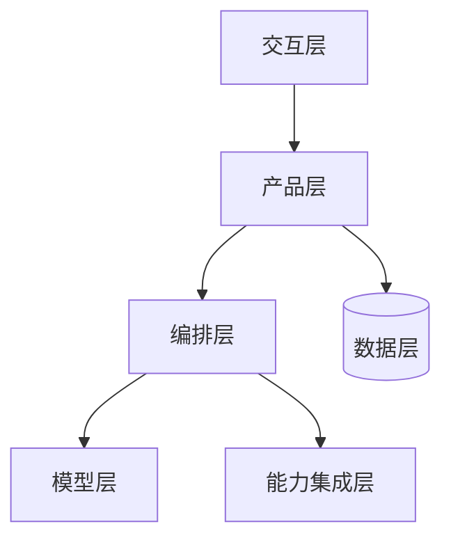
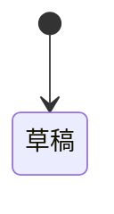

# {{产品名}} 技术方案 v{{版本}}

- 依据：PRD v{{版本}}、技术适配声明、原型 {{版本或「无」}}
- 状态：草稿 / 审稿中 / 定稿
- 一句话：{{形态}}；{{开发路径}}；{{终端}}

## 1. 形态判断

- 结论：单次调用 / 固定流水线 / Agent
- 依据：{{PRD 原文，注明章节}}
- 不选其他形态的原因：

## 2. 特征判断与组件选型

| 特征 | 问的是什么 | 判断 | 依据 |
|---|---|---|---|
| `destructive_ops` | 收不回的操作、隐私数据 | | |

选型结果（`scripts/select_components.py` 原样输出）：

{{粘贴脚本输出的表格}}

## 3. 七层架构

| 层 | 用什么 | 为什么 |
|---|---|---|
| ① 交互层 | | |
| ② 产品层 | | |
| ③ 编排层 | | |
| ④ 模型层 | | |
| ⑤ 能力集成层 | | |
| ⑥ 数据层 | | |
| ⑦ 基础设施层 | | |

- 安全边界：
- 可观测性：

## 4. 模型层

| 环节 | 能力要求 | 候选方向 | 选定模型（05 评测后回填） | 单次成本 |
|---|---|---|---|---|
| | | | 待评测 | |

- 调用方式：
- 主备切换：
- 超时与重试：
- token 上限：

## 5. 数据与状态

| 实体 | 关键字段 | 谁创建 | 存在哪 | 生命周期 |
|---|---|---|---|---|

全局上下文落地：

| 区块 | 存在哪 | 何时读 | 何时写 | 谁负责 |
|---|---|---|---|---|

## 6. 接口与工具

对前端的接口：

| 方法 | 路径 | 用途 | 请求要点 | 返回要点 | 错误码 |
|---|---|---|---|---|---|

给 Agent 的工具：

| 工具 | 实现方式 | 超时 | 失败时返回 |
|---|---|---|---|

## 7. 上下文与提示词落地

- 提示词存放：`prompts/<环节>.md`，第一版取自 PRD v{{版本}} 第四节原文
- 变量渲染：
- 结构化输出校验：
- 升版规则：改提示词升版本号，评测集全部重跑

## 8. 兜底实现

| PRD 兜底条目 | 在哪判断 | 阈值配置 | 降级做法 | 前端错误码 |
|---|---|---|---|---|

## 9. 可观测与埋点

- 模型调用日志：
- 链路轨迹：
- 埋点上报：

## 10. 成本测算

| 环节 | 每任务调用次数 | 输入 token | 输出 token | 单价（来源、日期） | 每任务成本 |
|---|---|---|---|---|---|

- 单次任务成本：{{}} 元【测算】；PRD 上限 {{}} 元
- 月成本：{{}} 元【测算】（按每月 {{}} 个任务）

## 11. 开发分期

| 期 | 范围 | 验收方式 | 依赖 |
|---|---|---|---|
| 1-1 | | | |

## 12. 风险与待定

| 风险 | 可能性 | 影响 | 应对 | 谁盯 |
|---|---|---|---|---|

待定项见 `决策台账.md`：{{编号}}

## 独立审稿

{{审稿结论、分数、问题与处理；不采纳的写理由}}

## 变更记录

| 时间 | 版本 | 改了什么 | 原因 |
|---|---|---|---|
